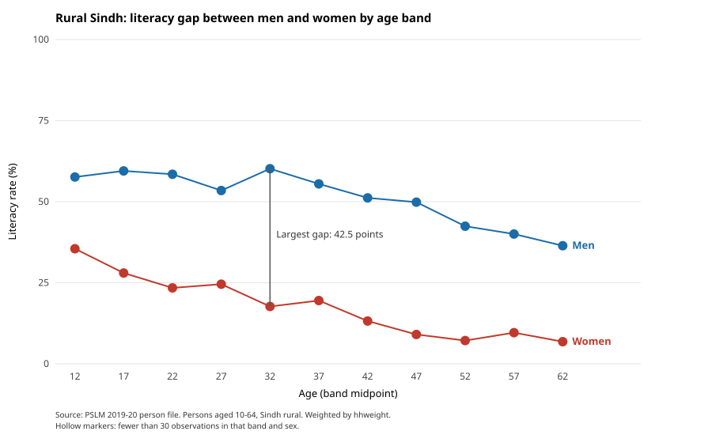

# ECO346 Assignment 1: Education spending and literacy in rural Sindh

**Registration no.:** FA24-BED-034 | **Variant:** 34 = 4 × 8 + 2, so variant 2 = **Sindh rural** (prov_code 3, urban_rural 1)

Data: PSLM 2019-20 person and household files (`data/`). Persons in variant: 10,960. Literacy sample (age 10-64, literate not missing): 7,171. Students (ed_total > 0): 1,440. All statistics are weighted by hhweight.

## Figures

### Q2: Distribution of education spending

### Q3: Literacy by age band (redesign)

### Q4: Default figure

### Q5: Python version

## Q2 results

- Students: 1,440
- Weighted median: Rs 4,500; unweighted median: Rs 4,295
- Weighted 10th percentile: Rs 1,000; 90th percentile: Rs 15,500; ratio: 15.50
- Excluded (outside Rs 100 to Rs 1,000,000): 1

Medians and percentiles use all students with ed_total > 0; the histogram uses those inside the plotted range.

**Answer:** Education spending in rural Sindh is unequal: the median student costs Rs 4,500 a year, and the 90th percentile (Rs 15,500) is 15.50 times the 10th (Rs 1,000). The distribution is roughly symmetric on the log scale with a long right tail. The weighted median is only slightly above the unweighted one (Rs 4,295), because sampled households carry unequal weights but the weights are only mildly related to spending.

## Q3 results

PASTE THE BAND TABLE FROM THE CONSOLE OUTPUT OF script 03 HERE (the lines under "README table:").

- Ages 15-19: women 28.0%, men 59.5%
- Ages 55-59: women 9.6%, men 40.0%
- Largest gap: ages 30-34, 42.5 points
- No band has fewer than 30 observations (smallest n = 77), so no markers are hollow.

**Interpretation:** Literacy falls with age for both sexes, but women start far lower: 28.0% of women aged 15-19 are literate versus 59.5% of men, and 9.6% versus 40.0% at 55-59. Older cohorts probably had less access to schooling, yet the gap among the young remains above 30 points. The 30-34 peak (42.5 points) is a one-band spike, not a trend. The figure cannot separate age effects from cohort effects, because it is a single cross-section.

## Q4: The makeover

The default is `ggplot(data, aes(age, literate)) + geom_point()`, saved in `figures/default.svg`.

**Explanation:** The default draws 7,171 points at 0 or 1, which overplot into two rows and show no rate. (1) I replaced raw points with weighted conditional means by five-year band, so the reader sees a rate. (2) Position on a common 0-100 scale, joined by lines, uses the most accurately perceived channel and shows the trend. (3) Direct end labels replace a legend, and gridlines are light, raising the data-ink share. (4) Hollow markers flag thin cells and one annotation marks the largest gap. The default shows individual ages; the redesign hides them by pooling ages into bands.

## Q5: Second language (Python)

- Women aged 15-19: R = 28.0, Python = 28.0
- 22 band-sex cells compared, 0 mismatches at one decimal.

**Answer:** Band closure. R's `cut()` defaults to right-closed intervals, which would put age 15 in 10-14 rather than 15-19. In both scripts I computed band starts with integer division, so every band is closed on the left. All 22 cells matched to one decimal.

The Python script uses only the standard library (pandas was blocked by a Windows Application Control policy on my computer) and draws the SVG by hand.

## How to run

Run from the repository root, in this order. No internet is needed.

1. `Rscript scripts/00_prepare.R` (loaded by the others)
2. `Rscript scripts/01_default.R`
3. `Rscript scripts/02_distribution.R`
4. `Rscript scripts/03_literacy_age.R` (writes `figures/band_table_R.csv`)
5. `python scripts/04_python_check.py` (reads that CSV and checks agreement)

`figures/band_table_R.csv` and `figures/band_table_python.csv` are the band tables written by scripts 03 and 04.
